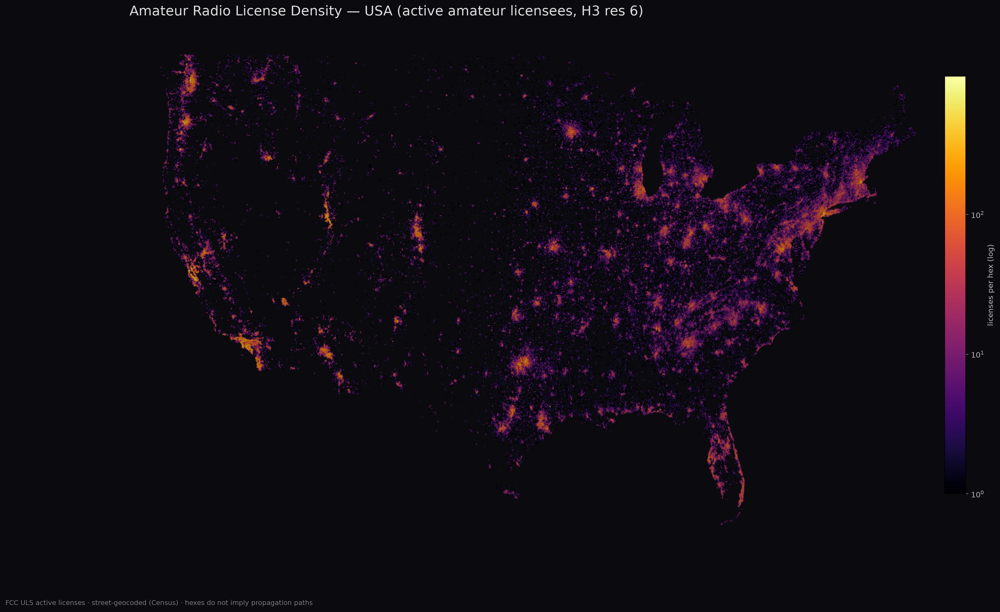

# Amateur Radio License Density Map — USA

Interactive high-resolution map of **726,874 active US amateur radio licenses**
(FCC ULS), geocoded to street level and binned into H3 hexagons that auto-refine
with zoom. Comes with a Python module that returns licensed-operator density as a
function of GPS coordinates and license class — useful for propagation planning,
antenna-pattern work, and contest/SOTA activation target selection.

**Live map: https://tgilton.github.io/HamMap/**



## Map features

- H3 hex bins at resolutions 5/6/7 (~253 → 5 km² cells), switching with zoom
- Class breakdowns: **All / General+ / Adv-Extra** (Techs can't touch most HF bands)
- Raw density or per-capita (county population) mode
- User-controlled contrast (gamma) slider on a log-density scale
- State outlines and labels; **Alaska / Hawaii** view presets
- Hover any hex for exact counts
- Works offline: the entire map (data + libraries) is one self-contained HTML file

## Using the map

- Open [`docs/index.html`](docs/index.html) directly in Chrome/Edge (Firefox/Safari
  block web workers on `file://` — instead double-click `open_map.command`, or just
  use the [live URL](https://tgilton.github.io/HamMap/)).
- Rebuild after refreshing the data: `python scripts/make_map.py`.

## The `hamdensity` Python module

```python
from hamdensity import load
pq = load()   # data/ham_points_slim.parquet

pq.count_within(43.5677, -116.1449, 100, cls="extra")   # Extra+Advanced hams within 100 km
pq.sector(43.5677, -116.1449, bearing=0, half_width=15, max_km=800, cls="general")
pq.azimuthal_profile(43.5677, -116.1449, n_sectors=36, max_km=3000, cls="all")
pq.top_callsigns(43.5677, -116.1449, radius_km=10, limit=10)
```

`cls` is one of `"all"`, `"tech"` (T/N — VHF+), `"general"` (G), `"extra"` (A/E — full HF).
Coordinates are WGS84; distances are great-circle km. The queries run on a
scipy KD-tree in ECEF space, so a full-continental azimuthal profile takes milliseconds.

## Reproducing the data

```bash
pip install pandas pyarrow requests h3 geopandas pyogrio shapely scipy matplotlib
python scripts/parse_uls.py         # FCC ULS weekly dump -> active licenses (~740k)
python scripts/geocode_batch.py     # US Census batch geocoder, ~96% street match
python scripts/assemble_points.py   # points w/ ZIP-centroid fallback
python scripts/bin_hex.py           # H3 bins + county attribution
python scripts/make_map.py          # self-contained map -> docs/index.html
python scripts/make_png.py          # static exports
```

The pipeline is weekly-refreshable: the FCC regenerates the ULS dump every Sunday
and the Census geocoder needs no API key. Expect ~1–2 hours end to end.

## Data & attribution

- **License data:** FCC Universal Licensing System (public domain), weekly dump.
  Active = status A and unexpired; 726,874 of 740k placeable (1.7% are unplaceable PO boxes).
- **Geocoding:** US Census TIGER Batch Geocoder (free, no key). The distributable
  slim dataset has ~88.5% street-level accuracy and contains no street addresses —
  only callsign, operating class, state, coordinates, and placement method.
- **Basemap:** © OpenStreetMap contributors, © CARTO (network-loaded; the hex
  overlay itself works offline).
- **Libraries:** MapLibre GL JS (BSD-3), h3-js (Apache-2.0), bundled in `scripts/vendor/`.
- QRZ.com is **not** used — their terms prohibit bulk redistribution.

## License

Code: MIT (see LICENSE). Derived datasets: CC0. Underlying FCC data is public domain.
